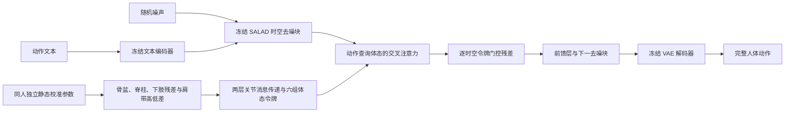

# 使用与文件说明

该分支实现用户提出的 SALAD 启发的体态条件模型。完整规则见 [冻结方案](PROTOCOL_zh.md)，机器可读输入约定见 [feature_spec.json](feature_spec.json)。



图中体态模块位于每个原始块的文本交叉注意力之后、前馈层之前。完整 50 步去噪作用于整段潜序列，箭头不是逐帧自回归。

## 运行环境

使用已通过原论文复现的独立 SALAD 环境，第一轮为 Python 3.9、PyTorch 1.13.1、CUDA 11.7。不修改原 SALAD 仓库的环境。需要官方 HumanML3D VAE、去噪模型、文本编码器、评估器及其词向量，路径沿用原项目 checkpoints 与 glove。独立工作树通过符号链接复用这些资产，不重复保存或上传。

服务器使用配置中的 data_self 和中性 SMPL-X 参考模型路径。原数据只读。特征与动作模型接口均经过真实权重短测；外部中性模型不是数据拟合资产一致性的证明。

## 命令

在仓库根目录运行：

```bash
python -m posture_conditioning.preflight
python -m posture_conditioning.geometry_audit
python -m posture_conditioning.train --variant fixed
python -m posture_conditioning.train --variant paired
python -m posture_conditioning.train --variant shuffled
python -m posture_conditioning.evaluate --seed 20261017
python -m posture_conditioning.report
python -m posture_conditioning.audit
```

训练入口会保护已有运行；中断后在原命令加 `--resume`，从 last.pt 保存的位置恢复。三组可以在显存允许时并行运行，但不得重复启动同一变体和种子。监督队列 campaign.py 用于本次已登记的三个进程，在训练结束后自动评价和按门槛停止；它不替代人工核验最终结果。

封存结果后不要在同一运行目录重跑短测或覆盖验收文件。新实验应使用新的工作树或运行目录，保留原始源码、数据与资产摘要。恢复训练必须继续使用原运行绑定的代码、配置和资产。

任意文本采样不接受目标动作值：

```bash
python -m posture_conditioning.sample \
  --text "A person squats down and stands up." \
  --identity SOURCE:SUBJECT \
  --checkpoint runs/posture_v1/paired/20261017/checkpoints/best.pt \
  --frames 120 --seed 20261017 --posture-scale 1 \
  --output runs/posture_v1/custom/squat.npz
```

将示例中的身份键替换为服务器数据实际身份。`--posture-scale 0` 旁路全部新增条件，回到原 SALAD。输出包含完整 263 维动作和 22 关节坐标，20 Hz，世界坐标 y 轴向上。

## 产物

```text
runs/posture_v1/
  cache/                         # 冻结 VAE 后验参数与文本特征
  preflight/                     # 真实权重短测、恢复、坐标审计
  fixed|paired|shuffled/
    20261017/
      bindings.json              # 数据及冻结主干摘要
      source_binding.json        # 实际执行源码摘要
      status.json
      validation.jsonl
      checkpoints/best.pt
      checkpoints/last.pt
  evaluation/20261017/
    original|fixed|paired|shuffled/
      denoise.csv
      generation.json
      0|1|2/                     # 完整动作、坐标、嵌入及物理统计
    interventions.csv
    attention_gate_residual.pt
  media/index.html               # 本地可打开的固定网格对照
results/posture_v1/
  REPORT_zh.md
  metrics.csv
  by_source.csv
  decision.json
  verification.json
  artifact_index.json
  posture_results.svg|pdf|tiff|png
```

cache 包含测试集经冻结编码器处理的无统计缓存，但训练抽样、损失和选模只使用对应训练／验证身份；没有用测试集估计归一化或其他可学习预处理。

GitHub 保留代码、协议、汇总、匿名结果图及文件摘要。逐人误差表、逐人干预、数据、完整模型检查点和媒体默认不上传。检查点只保存新增模块和恢复训练所需的状态，不重复保存冻结主干。

## 结果复核与媒体

以下命令用于已有结果的复核与交付；正式评价必须先完整结束。独立审计会重放全部主指标，复算生成覆盖、检索、FID、物理指标及全部输入干预，并核对冻结源码、资产与验证选模。

```bash
# 使用 SALAD 环境，仓库根目录。
python -m posture_conditioning.audit
python -m posture_conditioning.attention_summary

# 网格渲染使用服务器已有的 mdm5090 环境。
/root/miniconda3/envs/mdm5090/bin/python -m posture_conditioning.render
```

将 results/posture_v1 与 runs/posture_v1/media 同步到本地同名目录后，可使用具有 numpy、scipy、matplotlib、Pillow 的 Python 生成离线报告；此步骤不需要 PyTorch。

```bash
python -m posture_conditioning.figures
python -m posture_conditioning.page
node posture_conditioning/qa_browser.cjs /absolute/path/to/playwright
python -m posture_conditioning.delivery_audit
```

离线入口为 runs/posture_v1/media/index.html，无需启动服务器。浏览器验收使用已安装的 Edge，检查桌面和手机两种宽度、全部八视频播放、三个时刻三列人体像素与运动，另存截图供目视复核。播放器通过不等于动作自然度通过。将本地验收证据同步回服务器后，在 SALAD 环境运行 `python -m posture_conditioning.artifacts`，记录检查点与生成产物摘要、存储预算和训练停止状态。

本轮已执行结果见 `results/posture_v1/REPORT_zh.md`，交付验收及解释边界见 `results/posture_v1/DELIVERY_zh.md`。第一轮未通过主要研究门槛，按方案停止扩展训练。
