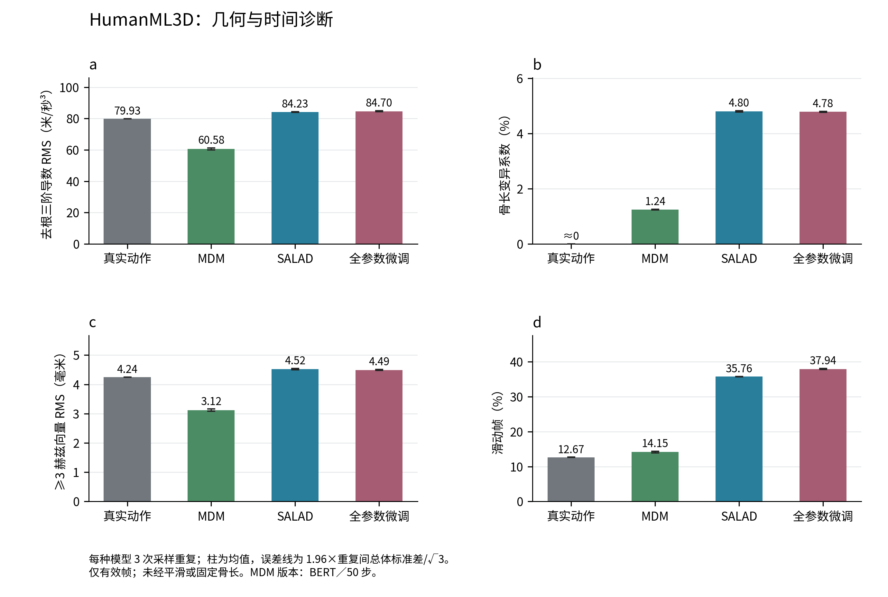
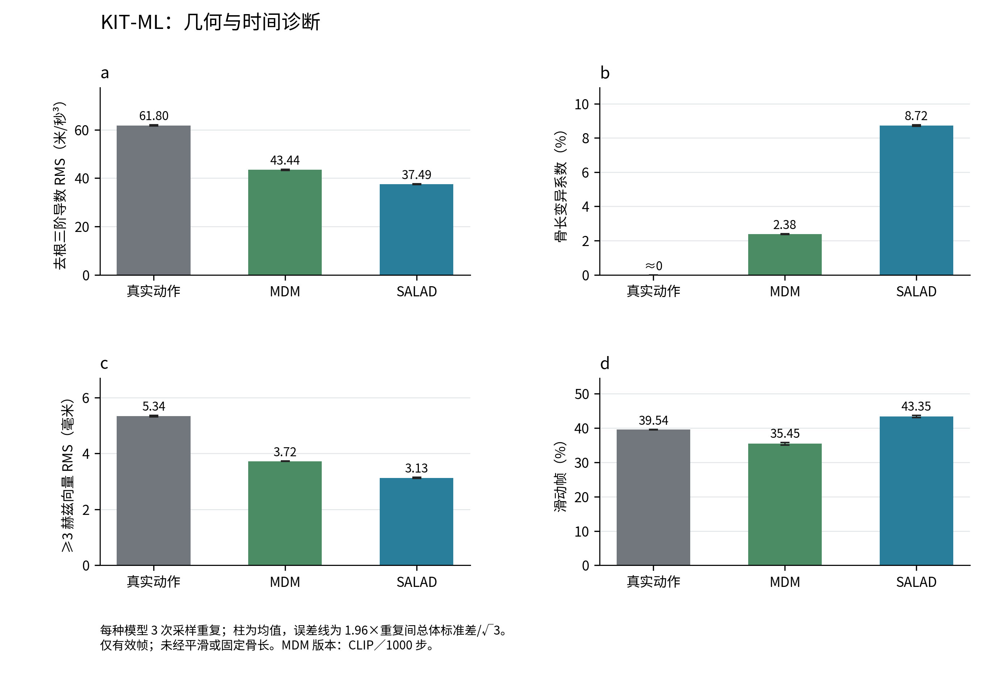
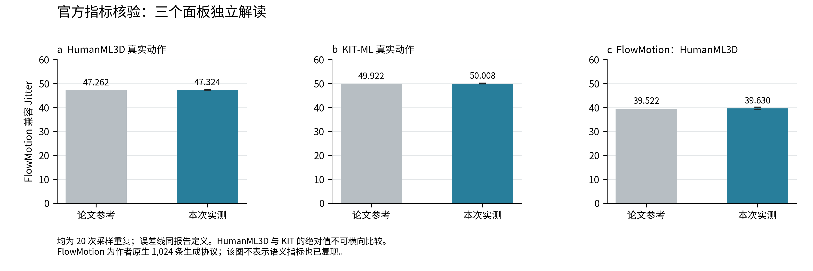

# SALAD 官方测试集：抖动、几何和语义评测

日期：2026-10-21。所有本轮模型结果均为实测。两套数据集独立报告，没有重新训练或对动作进行后处理。现有微调单列为全参数微调，不称为 LoRA；具体为既有去噪主干全参数适配，VAE和文本编码器仍冻结。

## 结论与完成范围

已完成两套真实动作各 20 次指标核验；原 SALAD 两套数据、HumanML3D 全参数微调、HumanML3D MDM（BERT／50步）、KIT-ML MDM（CLIP／1000步）各 3 次完整测试集采样；FlowMotion HumanML3D 采用作者原生 20 次评测。ViMoGen 未完成官方骨架、表示转换与评估器核验，因此没有填入未经验证的分数。

FlowMotion 的官方仓库为 [mccuba/FlowMotion](https://github.com/mccuba/FlowMotion)，固定提交 `fe4021b9170545b4e9ddc6d13d309bfa0988c83f`。[作者项目主页](https://mccuba.github.io/fm-page/)同时链接该仓库与论文 DOI `10.1016/j.cag.2025.104374`。指标实际为三阶差分模长均值，并非候选的加速度指标。Jitter 的论文参考数值沿用用户提供的表格；本轮直接复核了公开源码与预训练权重运行，出版商正文返回403，未独立读取原文表格。

| 数据集 | 本次真实动作 Jitter（20次） | 论文参考 | 相对偏差 |
| --- | --- | --- | --- |
| HumanML3D | 47.324 ± 0.071 | 47.262 | +0.1319% |
| KIT-ML | 50.008 ± 0.130 | 49.922 | +0.1721% |

相对差均通过预先采用的 1% 接近性检查；这不是统计等价证明。下方主表真实动作来自与 SALAD 同轮的 3 次采样，因此与上方 20 次核验略有抽样差别。

## HumanML3D

每轮 4,640 条，3 次重复。真实动作、SALAD、全参数微调及 MDM 使用逐批完全相同的文本、长度和真实动作。R 指标按每批 32 条检索计算，越高越好；其余主表指标越低通常越好，但低抖动也可能来自动作幅度变小或过度平滑。

| 指标 | 真实动作 | MDM（BERT／50步） | ViMoGen | SALAD | SALAD＋全参数微调 |
| --- | --- | --- | --- | --- | --- |
| FlowMotion 兼容 Jitter（原生全帧） | 47.333 ± 0.204 | 168.573 ± 3.912 | 未测 | 42.821 ± 0.190 | 42.712 ± 0.128 |
| FlowMotion 兼容 Jitter（统一零补齐） | 47.333 ± 0.204 | 39.188 ± 0.275 | 未测 | 42.821 ± 0.190 | 42.712 ± 0.128 |
| 去根三阶导数 RMS（米/秒³） | 79.929 ± 0.044 | 60.577 ± 0.570 | 未测 | 84.227 ± 0.217 | 84.696 ± 0.244 |
| 骨长变异系数（%） | 0.000 ± 0.000 | 1.238 ± 0.013 | 未测 | 4.797 ± 0.021 | 4.784 ± 0.015 |
| ≥3 赫兹向量 RMS（毫米） | 4.244 ± 0.002 | 3.122 ± 0.034 | 未测 | 4.521 ± 0.020 | 4.492 ± 0.017 |
| 滑动帧（%） | 12.668 ± 0.010 | 14.150 ± 0.232 | 未测 | 35.755 ± 0.078 | 37.939 ± 0.141 |
| FID | 0.000 ± 0.000 | 0.475 ± 0.004 | 未测 | 0.076 ± 0.007 | 0.162 ± 0.002 |
| 检索准确率 R@1 | 0.510 ± 0.003 | 0.561 ± 0.003 | 未测 | 0.578 ± 0.001 | 0.578 ± 0.004 |
| 检索准确率 R@2 | 0.702 ± 0.005 | 0.764 ± 0.007 | 未测 | 0.768 ± 0.002 | 0.765 ± 0.001 |
| 检索准确率 R@3 | 0.797 ± 0.004 | 0.852 ± 0.006 | 未测 | 0.856 ± 0.001 | 0.851 ± 0.005 |
| 文本动作匹配距离 | 2.970 ± 0.010 | 2.714 ± 0.010 | 未测 | 2.658 ± 0.006 | 2.669 ± 0.006 |

## KIT-ML

每轮 704 条，3 次重复。MDM 为该数据集公开的 CLIP／1000步原生采样权重，不能与 HumanML3D 的 BERT／50步版本视为同一配置。现有全参数微调是 22关节／263维 HumanML3D 架构；KIT 是 21关节／251维，没有对应权重，不适用。

| 指标 | 真实动作 | MDM（CLIP／1000步） | ViMoGen | SALAD | SALAD＋全参数微调 |
| --- | --- | --- | --- | --- | --- |
| FlowMotion 兼容 Jitter（原生全帧） | 50.156 ± 0.144 | 73.544 ± 1.094 | 未测 | 32.661 ± 0.237 | 不适用 |
| FlowMotion 兼容 Jitter（统一零补齐） | 50.156 ± 0.144 | 37.712 ± 0.080 | 未测 | 32.661 ± 0.237 | 不适用 |
| 去根三阶导数 RMS（米/秒³） | 61.801 ± 0.219 | 43.442 ± 0.201 | 未测 | 37.495 ± 0.185 | 不适用 |
| 骨长变异系数（%） | 0.000 ± 0.000 | 2.382 ± 0.014 | 未测 | 8.721 ± 0.037 | 不适用 |
| ≥3 赫兹向量 RMS（毫米） | 5.339 ± 0.024 | 3.725 ± 0.005 | 未测 | 3.130 ± 0.018 | 不适用 |
| 滑动帧（%） | 39.544 ± 0.055 | 35.446 ± 0.375 | 未测 | 43.351 ± 0.336 | 不适用 |
| FID | 0.000 ± 0.000 | 0.494 ± 0.043 | 未测 | 0.283 ± 0.023 | 不适用 |
| 检索准确率 R@1 | 0.443 ± 0.009 | 0.412 ± 0.018 | 未测 | 0.487 ± 0.019 | 不适用 |
| 检索准确率 R@2 | 0.684 ± 0.011 | 0.609 ± 0.007 | 未测 | 0.711 ± 0.002 | 不适用 |
| 检索准确率 R@3 | 0.792 ± 0.012 | 0.731 ± 0.007 | 未测 | 0.835 ± 0.006 | 不适用 |
| 文本动作匹配距离 | 2.763 ± 0.022 | 3.112 ± 0.015 | 未测 | 2.585 ± 0.029 | 不适用 |

## 如何理解这些结果

HumanML3D：SALAD 的去根三阶导数 RMS 为 84.23，真实动作为 79.93 米/秒³；骨长变异系数为 4.80%，真实动作约为 0.000045%；滑动帧为 35.76%，真实动作为 12.67%。因此应将时间变化、骨架几何与接触分别判断，不能用一个 Jitter 值概括自然度。

KIT-ML：SALAD 的去根三阶导数 RMS 为 37.49，真实动作为 61.80 米/秒³；骨长变异系数为 8.72%，真实动作约为 0.000054%；滑动帧为 43.35%，真实动作为 39.54%。因此应将时间变化、骨架几何与接触分别判断，不能用一个 Jitter 值概括自然度。

此前官方语义分数已接近 SALAD 论文，但本轮仍测到明显骨长变动。因此，骨长异常不能全部归因于 data_self 的域差异；它在官方测试集的原 SALAD 输出中也存在。这里检查的是直接恢复的关节坐标，没有经过网格蒙皮、逆运动学或渲染，不能把这部分几何异常归因于显示管线。

真实动作的骨长近似恒定与官方预处理使用固定骨架有关，不能解释为原始采集完全没有测量误差。三阶导数和高频能量也包含真实快速动作，并非纯粹的噪声；单独数值较高不能自动判断不自然。

现有全参数微调在 HumanML3D 上相对原 SALAD：FID 0.0763 → 0.1623，R@3 0.8558 → 0.8511；去根三阶导数 RMS 84.23 → 84.70，骨长变异系数 4.80% → 4.78%，滑动帧 35.76% → 37.94%。这是对官方原域的保持能力检查，不是 data_self 上的适配效果，也不是体态条件模型评测。

## FlowMotion 原生核验

作者原生每轮生成 1,024 条、GT 为 4,640 条，20 次重复；TCFM、Euler 步长 0.01、引导 2.5、种子 10。其 FID 样本数与主表不同，所以单列，不据此作严格同样本量排名。

| 指标 | FlowMotion HumanML3D 实测 |
| --- | --- |
| FlowMotion 兼容 Jitter（原生全帧） | 39.630 ± 0.546 |
| FlowMotion 兼容 Jitter（统一零补齐） | 未测 |
| 去根三阶导数 RMS（米/秒³） | 70.421 ± 1.016 |
| 骨长变异系数（%） | 1.489 ± 0.016 |
| ≥3 赫兹向量 RMS（毫米） | 3.711 ± 0.054 |
| 滑动帧（%） | 13.741 ± 0.248 |
| FID | 0.267 ± 0.030 |
| 检索准确率 R@1 | 0.376 ± 0.007 |
| 检索准确率 R@2 | 0.562 ± 0.007 |
| 检索准确率 R@3 | 0.670 ± 0.007 |
| 文本动作匹配距离 | 5.206 ± 0.029 |

论文提供的 FlowMotion Jitter 参考值为 39.522；本次为 39.630 ± 0.546。语义匹配与检索表现未达到预期，因此不能宣称完整复现了 FlowMotion 的论文结果。其公开代码在生成样本中将已补齐令牌数组的长度作为 `cap_len`，而真实动作使用有效句长。本轮保留作者原生代码，不用修订后的数值替换原结果。

针对句长的单因素对照：对已保存 SALAD 的首、中、末3批（共96条），保持文字令牌、动作和评估器不变，只把有效句长改成统一补齐长度22，匹配距离 2.6509 → 4.4828，R@3 0.8333 → 0.7188；动作嵌入逐值不变。这证明句长处理会影响该评估器的语义分数，但这不是 FlowMotion 生成动作上的修正实验，不能量化其完整影响，更不能解释仅依赖动作嵌入的 FID 差异。证据见 `evidence/text_length_control.json`。

FlowMotion 原生 FID／检索／匹配分数来自日志，每轮保留 4 位小数；上表由这些逐轮数值重算。物理指标与 Jitter 由观测钩子保存，保留完整精度。公开仓库未找到 KIT 权重，所以 KIT 的 FlowMotion 模型尚未核验。

## 两套指标的定义

**FlowMotion 兼容 Jitter**：世界坐标三阶差分乘 20³，先取三维模长，再对帧、关节和动作取均值。作者使用完整 196 帧，包括补齐区域；KIT 额外乘 0.00073，并硬编码恢复 22 关节。KIT 实际仅 21 关节，额外关节来自前三个旋转特征。该列为了与作者实现对照保留这些行为，不称为 KIT 的 SI 物理单位。

**物理诊断**：仅有效帧，HumanML3D 为 22 关节、20帧/秒、米；KIT 为 21 关节、12.5帧/秒，毫米乘 0.001 转米。去根表示每帧减去骨盆位置。三阶导数 RMS 先对三维平方求和，再对帧和关节平均开方。骨长 CV 为每根骨骼时间标准差除以均值，再对骨骼平均。高频为去根去均值坐标的正交 DCT-II，保留频率≥3赫兹的能量，报告三维向量 RMS。

**滑动**：脚尖相邻两帧均不高于 5厘米，且水平速度大于 0.2米/秒；任一脚触发的时间间隔占比。HumanML3D 脚尖为10／11，KIT为15／20。它是高度代理，完整测试集含复杂动作，不能当作真实接触标签或只针对平地行走的认证。真实动作也可能触发较高比例。

SALAD 的作者评估把有效长度外的归一化输出置零，MDM／FlowMotion 原生评估保留模型输出；兼容 Jitter 因而受各自补齐行为影响。所有结果还保存有效帧 Jitter；MDM 额外保存统一置零补齐后的 Jitter。有效帧物理指标不受补齐边界影响。动作之间没有拼接差分。

| 数据集／模型 | 原生全帧兼容 Jitter | 统一置零补齐 | 仅有效帧、实际关节 |
| --- | --- | --- | --- |
| HumanML3D／SALAD | 42.821 ± 0.190 | 42.821 ± 0.190 | 48.912 ± 0.105 |
| HumanML3D／真实动作 | 47.333 ± 0.204 | 47.333 ± 0.204 | 48.844 ± 0.009 |
| HumanML3D／SALAD＋全参数微调 | 42.712 ± 0.128 | 42.712 ± 0.128 | 49.477 ± 0.137 |
| HumanML3D／MDM（BERT／50步） | 168.573 ± 3.912 | 39.188 ± 0.275 | 35.878 ± 0.278 |
| KIT-ML／SALAD | 32.661 ± 0.237 | 32.661 ± 0.237 | 74.062 ± 0.308 |
| KIT-ML／真实动作 | 50.156 ± 0.144 | 50.156 ± 0.144 | 111.796 ± 0.458 |
| KIT-ML／MDM（CLIP／1000步） | 73.544 ± 1.094 | 37.712 ± 0.080 | 71.894 ± 0.094 |

上表有效帧列仍使用作者默认20帧/秒及KIT的0.00073缩放，仅用于核查指标口径。KIT有效帧列还移除了虚构的第22关节，变化不能全部归因于补齐。物理时间尺度请以主表诊断指标为准。

## 重复、验证与限制

每条动作先独立计算，再在一轮内等权平均，最后在重复间取均值。±表示 1.96×重复间总体标准差/√重复数，沿用上游口径，只描述固定权重的采样变化。3 次重复不足以证明稳定的总体优越性；它们不是独立训练种子，也不是独立受试者重复。未计算多模态分数或将生成动作与 GT 逐帧比较的 MPJPE。

主表 GT 的 FID=0 为同一批真实动作嵌入与自身的恒等对照，不是两个独立随机GT子集之间的FID；FlowMotion原生流程的随机GT参考另按其代码执行。

独立验证检查全部逐片段覆盖及聚合；每模型每轮抽取首、中、末批各3条，以双精度独立恢复、逐级差分、显式余弦矩阵重新检查三阶导数与高频；另独立检查骨长、滑动和特征值法 FID。原 SALAD 与全参数微调全部435批输入逐值配对；MDM 输入缓存通过保存的 SHA-256 绑定。具体误差见 `evidence/verification.json`。抽查不等于全部动作逐值重生成。

ViMoGen 现有权重使用不同的276维表示和身体模型；现有工程包含其他任务的用户改动，尚未验证官方21关节／251维KIT及HumanML评估转换。表中保留未测，不填论文数值，也未为完成表格而修改其骨架。LoRA 无对应权重，本轮未测试。

## 既有 SALAD 语义复现

以下为此前完成的正式20次评测，单独保留溯源，未和本轮物理采样拼成同一次实验。

| 数据集 | 既有实测 FID | 论文 FID | 既有实测 R@3 | 论文 R@3 |
| --- | --- | --- | --- | --- |
| HumanML3D | 0.078 ± 0.003 | 0.076 | 0.856 ± 0.003 | 0.857 |
| KIT-ML | 0.296 ± 0.013 | 0.296 | 0.825 ± 0.004 | 0.828 |

## 交付文件

- `REPORT_zh.md`：本报告；三个 PNG 为本轮图表。
- `main_summary.csv`、`sampling_repetitions.csv`、`results.json`：聚合值与逐轮结果。
- `flow_native_summary.json`：原生 FlowMotion 的物理与语义核验。
- `evidence/`：权重和源码绑定、状态、逐轮结果、独立验证，以及既有正式语义评测的来源。
- 对应源码为仓库 `reproduction/official_jitter_v1/`；全量动作、模型权重和逐片段缓存仅服务器保存，不上传 GitHub。
