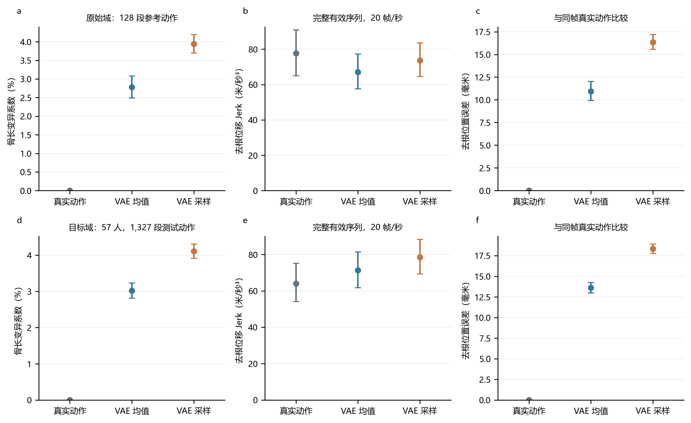
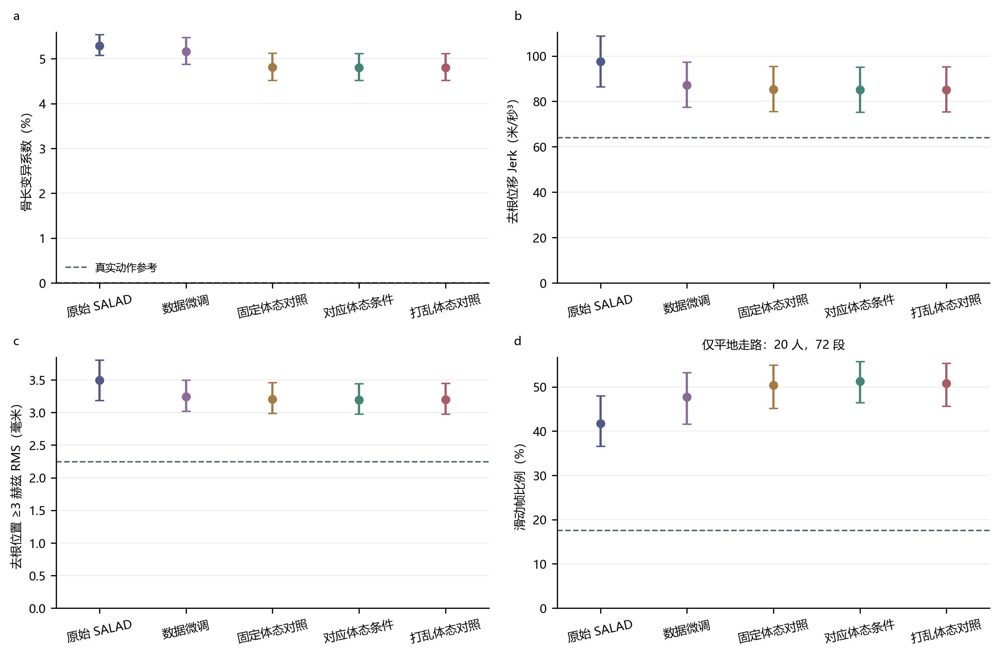
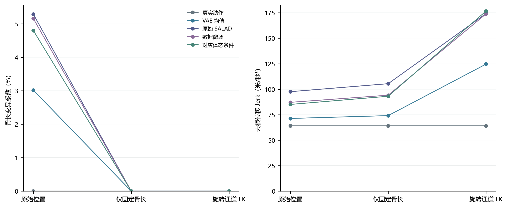
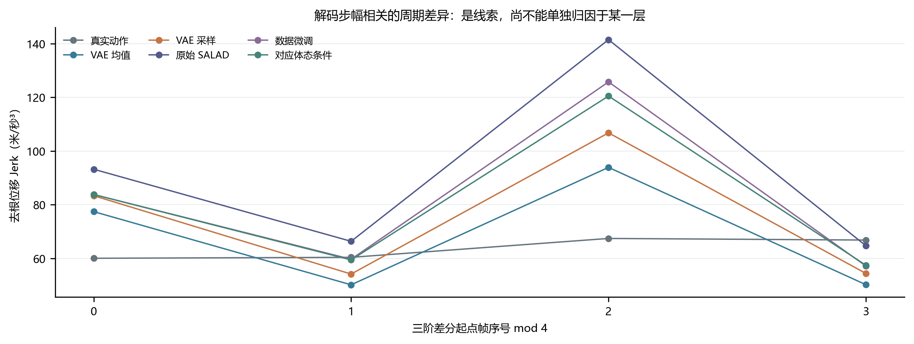
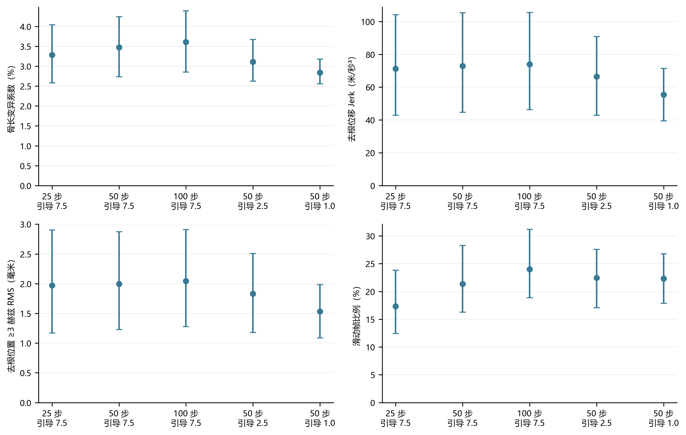
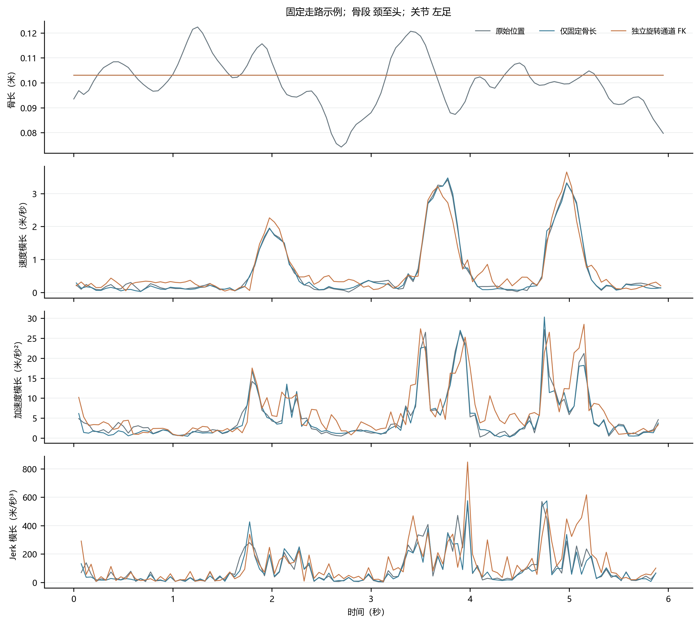

# SALAD 抖动来源分层诊断

日期：2026-10-21。性质：独立事后诊断；未训练、未改变原权重、原数据划分或正式评价结果。

## 结论与证据边界

1. **骨长波动首先在官方 VAE 重建阶段就已出现，不能只归因于目标数据泛化、扩散生成或蒙皮。** 原始域真实动作的骨长 CV 近零，VAE 均值重建为 2.778%，后验采样为 3.944%；目标域分别为 3.016% 和 4.110%。确定性后验均值也有问题，因此并非只是后验随机采样造成。
2. **扩散生成还存在额外误差，但不能把其总误差简单分解成 VAE 与扩散的可相加贡献。** 目标域原 SALAD 骨长 CV 5.290%、Jerk 97.57；VAE 均值重建为 3.016%、71.28。生成与重建不是同一动作，差值提供分层线索，不能称逐帧因果贡献率。
3. **位置和旋转通道不一致，固定骨长不是时间平滑的保证。** 目标域原 SALAD 位置与独立旋转 FK 的去根位置差约 66.80 毫米；真实动作约为浮点误差。只固定原骨段长度后，Jerk 从 97.57 升到 105.41；改用独立旋转通道 FK 后为 174.32。不能将旋转 FK 当作已解决抖动的替代方案。
4. **数据微调降低了一部分时间指标，未解决物理问题。** 整体 Jerk 下降 10.72%，≥3 赫兹位置 RMS 下降 7.18%；骨长 CV 仅从 5.290% 变为 5.159%。平地行走滑动帧比例从 41.70% 增至 47.69%。
5. **体态条件没有显示出有实际幅度的、依赖正确对应关系的抖动改善。** 对应体态相对数据微调 Jerk 下降 2.36%，但固定体态对照也下降 2.15%；对应与打乱条件的 Jerk 仅差约 0.05%，配对区间跨零。平地滑动进一步到 51.22%，比数据微调增加 3.53 个百分点。

上述定位并不代表已经修复模型，也没有确定某一损失项或网络层的因果贡献。

## 范围与协议

- VAE：原始域固定 128 段真实参考；目标域全部 1,327 段、57 名测试受试者。比较真实动作、后验均值解码、后验采样解码，各走三条恢复路径，共 13,095 行。
- 完整生成缓存：原 SALAD、数据微调、固定体态、对应体态、打乱体态五种模型，各 1,327 段、3 个生成重复、3 条恢复路径；另加原始域 384 条位置生成缓存，共 60,099 行。
- 采样探针：此前固定的站立、行走、慢走、跑、蹲、跳六条文本，3 个固定种子，5 种设置，共 90 条生成、270 行恢复记录。
- 数据仍按受试者分组：训练/验证/测试为 256/56/57 人，动作 5,299/1,061/1,327。身份组不交叉；沿用已有身份组定义，未另做跨数据源真实身份审计。
- 同一有效整段、20 帧/秒、米制、世界 Y 竖直；不跨片段求导，不计补零帧。VAE 按精确长度分组，没有补零。
- 先片段内平均生成重复，再在人内平均片段，最后人等权。95% 区间为受试者配对自助法 4,000 次。原始域去掉镜像编号前缀后聚类，但不是已知真人身份划分。采样探针按六条文本聚类，仅作探索。
- 本次使用已训练的旧体态条件版本。固定世界竖直的新 `posture-world-up-v2` 没有对应训练权重，未将新条件混配给旧模型。

## 1. 仅测 VAE 重建

所有数值为受试者等权均值。Jerk 单位为米/秒³；位置误差为去根平均关节位置误差（MPJPE）；加速度误差单位为米/秒²。

| 数据域 | 路径 | 骨长 CV（%） | Jerk | 位置误差（毫米） | 加速度误差 |
| --- | --- | ---: | ---: | ---: | ---: |
| 原始域 | 真实动作 | 0.000 | 77.66 | 不适用 | 不适用 |
| 原始域 | VAE 后验均值 | 2.778 | 67.03 | 10.94 | 2.818 |
| 原始域 | VAE 后验采样 | 3.944 | 73.59 | 16.35 | 3.159 |
| 目标域 | 真实动作 | 0.000 | 64.04 | 不适用 | 不适用 |
| 目标域 | VAE 后验均值 | 3.016 | 71.28 | 13.60 | 2.558 |
| 目标域 | VAE 后验采样 | 4.110 | 78.57 | 18.33 | 2.932 |

原始域重建 Jerk 低于真实动作，不能据此判定重建无问题：VAE 同时削弱真实动作的快速变化并引入新的重建误差。原始域均值重建的加速度误差 2.818、Jerk 误差 83.79，而骨长 CV 与骨长高频分量仍明显大于零。目标域均值/采样重建的骨长 ≥3 赫兹 CV 分别约 0.595%/0.723%。

这一步明确排除了“只有目标域分布外才会有骨长问题”的解释，但没有把编码器、解码器、潜变量压缩和训练目标之间的责任进一步因果拆开。

本报告的目标域“真实动作”指既有拟合并转换为 HumanML3D 的参考序列；固定骨长本来就是处理约束，不代表每个关节都经过直接实测，也不认证输入自身没有拟合或观测噪声。本次比较的是处理后的输入与重建，不将全部参考高频变化视为可靠人体运动。

## 2. 完整生成序列与微调对照

前三项使用 57 人、1,327 段全部测试动作；滑动只采用原正式协议筛出的 20 人、72 段平地走路，避免将楼梯、斜坡等动作按单一平面误判。

| 模型 | 骨长 CV（%） | 去根 Jerk（米/秒³） | ≥3 赫兹位置 RMS（毫米） | 平地滑动帧（%） |
| --- | ---: | ---: | ---: | ---: |
| 真实动作参考 | 0.000 | 64.04 | 2.244 | 17.51 |
| 原始 SALAD | 5.290 | 97.57 | 3.494 | 41.70 |
| 仅数据微调 | 5.159 | 87.11 | 3.243 | 47.69 |
| 固定体态对照 | 4.808 | 85.23 | 3.204 | 50.41 |
| 对应体态条件 | 4.800 | 85.05 | 3.194 | 51.22 |
| 打乱体态对照 | 4.800 | 85.10 | 3.197 | 50.79 |

原 SALAD 骨长 CV 最大的几个骨段为颈至头 11.534%、左足 7.595%、上脊柱 7.530%；左右大腿约 2.556%/2.812%，左右小腿约 4.931%/4.976%。各骨段相对变异有差别，不能把所有骨骼都说成 5.29%；全表见逐骨汇总 CSV。

每根骨骼的逐帧长度、每关节速度/加速度/Jerk 模长已在服务器按批保存，包含完整有效长度；逐骨、逐关节总体结果见 `summary/*_bone_summary.csv`、`summary/*_joint_summary.csv`。导数原始序列与细粒度指标未全部下载，避免复制多 GB 的诊断缓存。

配对变化的部分 95% 区间：

- 数据微调减原 SALAD：Jerk −10.46［−14.42，−6.62］；骨长 CV −0.132 个百分点［−0.263，+0.001］。骨长改善幅度有限，区间覆盖零。
- 对应体态减数据微调：Jerk −2.06［−2.59，−1.45］；平地滑动 +3.53 个百分点［+1.11，+6.36］。
- 打乱体态减对应体态：Jerk +0.046［−0.106，+0.212］。不能把适配器额外训练带来的变化直接说成学到了个人体态响应。

区间为描述性结果，不作多重比较校正后的显著性声明。三个是生成重复，未覆盖多个独立训练种子。

## 3. 同一结果的三种恢复

`position` 为作者从相对位置通道直接恢复的 22 关节。`position_fixed` 保留每一时刻的骨段方向与根轨迹，仅换为同一固定骨长，逐层累积位置，不做时间滤波。`rotation_fk` 读取同一 263 维结果的独立 6D 旋转通道，调用作者固定骨架正向运动学。

全部固定骨架使用作者 `000021` 参考动作首帧的同一组骨段偏移；没有逐帧身高缩放。原位置本来存在骨长变化，因此不人为缩放其瞬时身高来隐藏缺陷。固定方向与旋转两路径具有同一组固定骨长。

| 数据或模型 | 原位置 Jerk | 仅固定骨长 Jerk | 旋转通道 FK Jerk |
| --- | ---: | ---: | ---: |
| 真实动作 | 64.04 | 64.04 | 64.04 |
| VAE 均值重建 | 71.28 | 74.06 | 124.67 |
| 原始 SALAD | 97.57 | 105.41 | 174.32 |
| 数据微调 | 87.11 | 94.11 | 173.97 |
| 对应体态条件 | 85.05 | 93.06 | 176.76 |

三条路径根轨迹逐值一致；位置恢复与独立公式、FK 与独立矩阵累乘通过核验。所有固定路径骨长误差为浮点量级。目标域真实动作两通道基本一致，而重建/生成后分离，因此不能把生成时的不一致归咎于相机或渲染。

旋转转正交矩阵、骨架层级的累积会使独立旋转预测误差表现为更大位置变化，但本次未以替代旋转损失或逐层消融验证哪个环节占比最大。原始域旧参考中存在此前已记录的少量位置/旋转整体朝向差；此次没有逐帧对齐来掩盖它，也没有将生成位置/FK差称为对真实动作的误差。

## 4. 时间连续性、解码周期与采样设置

Jerk 使用去根位置的三阶前向差分，并乘 20³，先求三维向量平方范数再取时空均方根；不是三个坐标的均方根。旧报告若采用坐标 RMS，数值会差 √3，不能直接拼表。

≥3 赫兹分量采用去均值后正交 DCT-II，频率 k×20/(2T)，同时保留 2/3/4/5 赫兹的 RMS 和能量占比。高频包含真实运动，并受有限片段边界影响，不等同不自然抖动。

排除首尾各四帧后，目标域真实/原 SALAD/数据微调/对应体态 Jerk 分别为 65.69/94.14/82.19/79.68。生成误差并非只集中在片段首尾。

按三阶差分起点 mod 4 分组，真实动作 Jerk 约 60.04/60.39/67.43/66.83；VAE 均值为 77.42/50.15/93.92/50.19，原 SALAD 为 93.22/66.36/141.52/64.71。确定性重建已出现显著周期差异；作者解码器恰好使用两次二倍时间上采样，这使解码时间重建成为值得优先排查的环节，但该相关性尚不是上采样层因果消融。

以下探针保持每个种子的初始噪声完全一致，沿用作者采样器。默认 50 步、引导 7.5 对原 18 条缓存逐值重放最大误差为零。

| 步数 / 引导强度 | 骨长 CV（%） | Jerk | ≥3 赫兹 RMS（毫米） | 滑动帧（%） |
| --- | ---: | ---: | ---: | ---: |
| 25 / 7.5 | 3.286 | 71.26 | 1.972 | 17.32 |
| 50 / 7.5（默认） | 3.477 | 72.86 | 1.996 | 21.34 |
| 100 / 7.5 | 3.615 | 73.94 | 2.043 | 24.00 |
| 50 / 2.5 | 3.113 | 66.56 | 1.830 | 22.46 |
| 50 / 1.0 | 2.844 | 55.43 | 1.531 | 22.32 |

增加采样步数没有自动解决问题；降低文本引导降低了本组六条文本的时间指标，但动作语义和幅度可能随之改变，不能把它直接当作全面质量更好的采样配置。未据此重新选择正式评价设置。

潜变量粗统计：原始域后验采样的解码再编码 RMS 约 0.541，默认生成约 0.549；两者量级接近。本次探针不支持仅凭粗均值/方差就断言“生成潜变量严重偏离分布”；它也不能排除更细的局部或联合分布问题。

## 5. 接触与滑动的限制

脚尖在相邻两帧均不高于 5 厘米、水平速度超过 0.2 米/秒时计为滑动；记录任意一脚满足条件的帧区间比例。同时保存接触时条件滑动比例、接触覆盖率、脚速、穿地，以及 3×3 高度/速度阈值敏感性表。

真实平地动作也有 17.51% 触发该代理指标，说明它不是人工判定的真实滑步率。原 SALAD、数据微调、对应体态在“有低脚接触区间”内的滑动比例约为 52.60%/52.77%/54.13%，并非单靠动作变腾空来降低滑动。

全任务混合滑动数值也保存于 `summary.json`，但不用于物理改善结论。全任务包含楼梯和斜坡等，混合后趋势会与平地子集相反。平地子集重算逐值复现原正式物理汇总，最大误差小于 1e-10。

## 代码机制检查与下一步优先级

作者 VAE 重建损失为表示重建、速度通道重建、相对位置通道重建和 KL 项之和。这里速度项监督 263 维表示中的速度通道，不是从恢复位置重新求导后计算的一致性。该目标未显式约束逐帧恒定骨长、位置与旋转 FK 一致、加速度或 Jerk。

这一结构与实测缺陷吻合，但“缺少某项损失”是机制解释，不是通过重训消融证明的唯一原因。优先建议单独验证 VAE：固定后验均值，加入骨长和位置/旋转一致性，再验证由位置导出的速度/加速度及接触约束；同时检查步幅相关周期误差。只有确认重建基线改善，再讨论扩散时间建模与潜变量约束。此报告没有启动这些训练。

## 媒体、文件与核验

- `media/vae_reconstruction.mp4`：同一条真实走路与两种 VAE 重建，44 帧。
- `media/recovery_paths.mp4`：同一原 SALAD 走路的三恢复路径，120 帧。
- `media/finetuning.mp4`：同一目标文本的原模型、数据微调、对应体态模型，44 帧。
- 视频上排为直接骨架，下排为沿用已核验几何旋转估计与标准 SMPL-H 蒙皮；相同中性体型、米制相机尺度与高度，各列按同一规则跟随自身水平根轨迹。同一结果的三种恢复根轨迹逐值一致，相机完全相同；不同模型行进距离不同，仅显示时跟随各自根，未改变数值动作。无时间平滑、锁脚、逐帧贴地或逐帧身高缩放。表面轴向扭转不能由位置唯一恢复，网格是估计表面，不作为数值真值。
- `summary/group_means.csv`、`paired_comparisons.json`、`flat_walking.json`、逐骨/逐关节汇总为可复算结果；服务器保留原逐片段 CSV 与完整时间序列。
- `summary/verification.json` 与 `independent_verification.json`：输入/输出哈希、记录数、受试者划分、五模型文本/长度/种子一致，以及独立解析导数、余弦矩阵频谱、分组汇总核验。
- 四项解析测试与预检通过；三个视频全部解码、帧率/尺寸/有效帧及前景检查通过。PNG 已逐图检查可读性。数值核验不等于逐帧人工自然度验收。

图片按用户要求仅 PNG。报告采用网页阅读尺寸和 300 dpi，不额外生成 SVG、PDF 或 TIFF；通用科研图验证器对向量格式的默认要求由本次明确导出约束覆盖。
